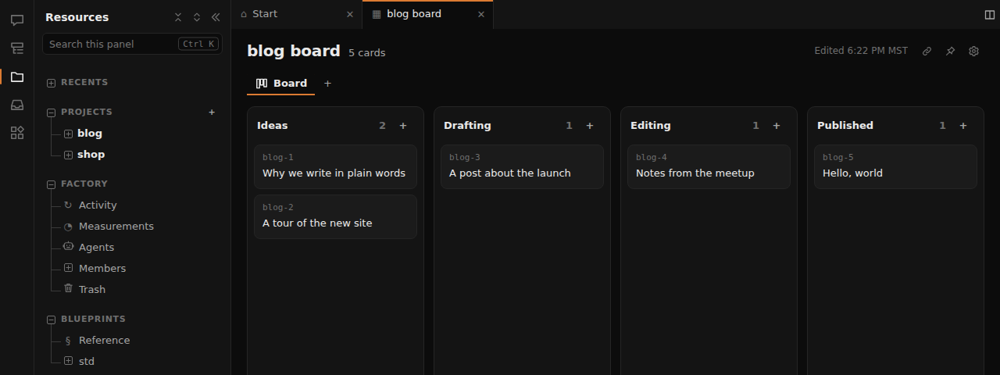
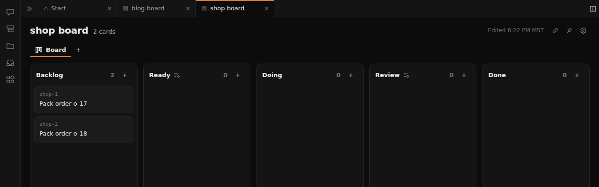
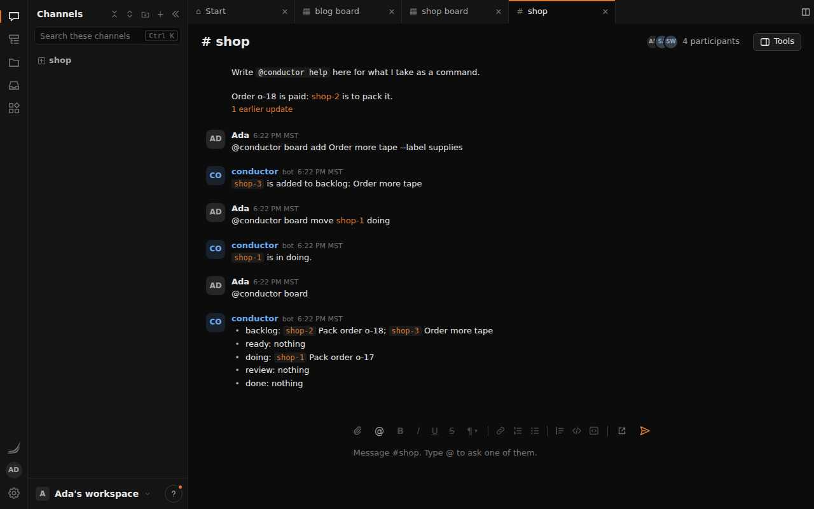
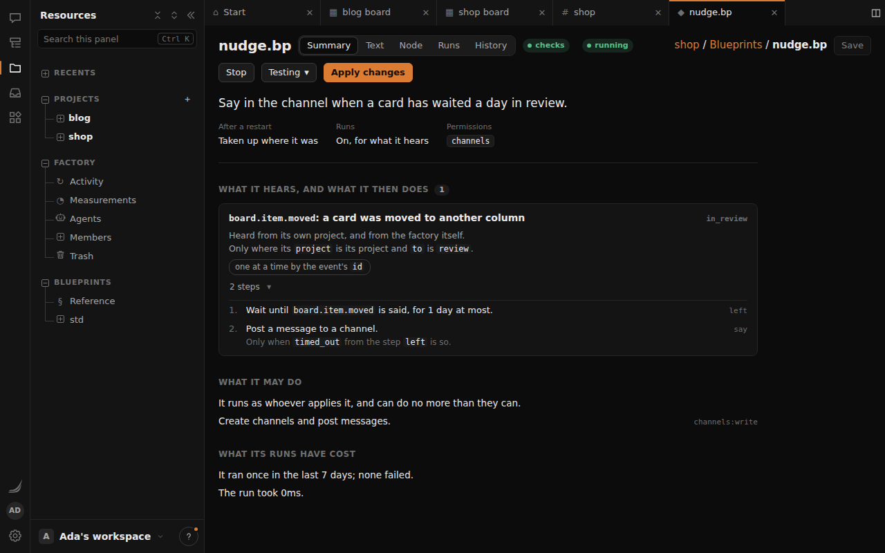
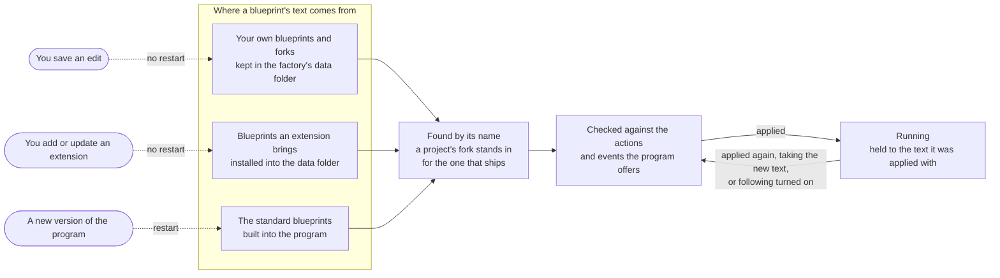

<p align="center">
  <picture>
    <source media="(prefers-color-scheme: dark)" srcset="docs/brand/lockup-light.svg">
    
  </picture>
</p>

<p align="center">
  <a href="https://github.com/mythwrightai/mythwright/actions/workflows/nightly.yml"></a>
  <a href="https://x.com/MythwrightAI"></a>
  <a href="https://github.com/sponsors/adamGrgic"></a>
</p>

# Mythwright

**Build your most ambitious software with confidence.**

Run agents as a team on your own machine, arranged the way you choose.
A/B anything about how they work (a model, a prompt, a whole way of doing
a card) on your real backlog, and read the counts side by side. Canary
what they ship.

Mythwright is a software factory you run yourself, for small teams to
build and maintain large projects with agents. People and agents talk in
channels and work from a board, and what happens to the work is written in
**blueprints**: short files that a daemon runs, keeps running across
restarts, and updates while they run.

It runs on your machine and sends nothing anywhere by itself: no telemetry
and no update checks. The agents are the ones you
already use: Mythwright runs their own programs, signed in as you, and adds
the place where their work is handed out, reviewed, measured and kept.

Setting it up with an agent? Point it at [AGENTS.md](AGENTS.md).

What you can do with it today, each covered in more detail below:

- Start it and it is yours: the first start makes you its owner, and `mw open` opens it in a browser, signed in.
- Have agents work your board: each card is taken, worked on a branch of its own, reviewed (by you, an agent or a council) and merged.
- Arrange the agents by editing rows in two tables (who is in the fleet, and what is done in each column), even while work is under way.
- Try two ways of working (a model, a prompt, a whole way of doing a card) on real work, and compare the counts side by side ([one real run, two models on five of our own cards](docs/ab-run-opus-sol.md)).
- Write blueprints, read a plain-language summary of each, preview, sandbox-test and fork them, and change one while it runs.
- Talk in channels, threads, private channels, conversations and a forum's topics; anything that mentions you waits in your inbox.
- Keep a project's tables, documents and mockups, with comments, attachments, history and a Trash.
- Run a project's own pipelines by hand, or when a branch moves, a card reaches a column or a set time comes, under environments with feature flags and approvals.
- Read a project's repository on its Git page; with the GitHub package, open pull requests and keep issues in sync with cards (tried against one GitHub repository so far).
- Use it in a browser or in its own window, with a theme of your own and nothing sent anywhere.

A whole blueprint can be this short:

```yaml
blueprint: greeter
description: Say so in a channel whenever a card of this project is done.
permissions: [channels]

steps:
  room:
    do: channel.ensure
    with: { name: general }

on:
  done:
    event: board.item.moved
    for: { project: "${instance.project}", to: done }
    do: channel.post
    with:
      channel: general
      body: "${event.data.title} is done."
```

When you apply it to a project (`mw apply greeter.bp --project shop`), it
is checked against what the daemon offers, down to the fields that event
carries. Its step runs once and creates the channel if it does not exist;
after that the blueprint stays alive and posts a message each time a card
in that project reaches *done*. Change the sentence and apply it again, and
the running blueprint picks up the new text in place.

## Before you start

- **Linux on x86_64 is the only system it is tested on.** Windows has
  been tried lightly; macOS is supported in the code but has never been run.
- **Copy your data before you upgrade.** There is no promise yet that data,
  or blueprints you write, will carry over from one version to the next
  ([Which build](#which-build)).
- **Agents run on your own accounts with their providers**, and what they
  use is billed to you. Each card shows what it cost, round by round, to
  the extent the agent's program reports it (`mw board cost <card>`).
- **Mythwright sends nothing anywhere on its own**: no telemetry, no update
  checks.

[Known limitations](#known-limitations) lists the rest, and [Product
vision](#product-vision) describes where it is going.

## Blueprints, by example

Everything in Mythwright happens through blueprints. A board, a fleet of
agents, a pipeline, a rule about who is notified of what: each is a short
text that the daemon checks before running any of it, keeps running across
restarts, and updates while it runs. The blueprints that ship are written
the same way as yours, and yours can call them. A test (`api`: `readme.rs`)
checks every blueprint in this README, holds it to the layout `mw fmt`
gives it, and plays it as described here. `ui/scripts/readme.mjs`
regenerates the pictures from these texts (`WRITE_README=1` into `docs/readme/`).
Five longer use cases each follow one piece of work from start to finish:
[A/B testing a change to a service](docs/example-ab-service.md),
[choosing a model or a prompt on your real work](docs/example-choosing-models.md),
[a repository that looks after itself overnight](docs/example-self-maintaining.md),
[a team wiki kept current by agents](docs/example-team-wiki.md)
and [every branch tried before it lands](docs/example-preview-pipeline.md).

### A board in your own columns

A project's board is itself a blueprint, `std/board`. To get a board with
the columns your team works in, call that blueprint with them:

```yaml
blueprint: writing
description: A board for a small team that writes, in the columns it works in.
permissions: [projects, board, blueprints]

steps:
  board:
    call: std/board
    with:
      columns: [ideas, drafting, editing, published]
```

```sh
mw project create blog --bare                # a project with nothing in it yet
mw apply writing.bp --project blog
mw board add blog "A post about the launch"  # added to ideas, the first column
mw board move blog-1 drafting
```

The board's page shows the four columns. Underneath, a board is a table,
so the same cards can also be laid out as a table, a calendar or a gallery.
(The project is created bare because the default fleet works the default
columns.)



### An event of your own

Anything can be sent as an event under a topic of your own, and a
blueprint can listen for it. Here, a shop's payments, which happen outside
the factory, become cards to pack. The project is made as in [The first ten
minutes](#the-first-ten-minutes), with its board and its channel:

```yaml
blueprint: orders
description: Put a card on the board for each order that is paid, and say so in the channel.
permissions: [board, channels]

on:
  paid:
    event: shop.paid
    outside: true
    steps:
      card:
        do: board.add
        with:
          project: "${instance.project}"
          title: "Pack order ${event.data.order}"

      said:
        needs: [card]
        do: channel.post
        with:
          channel: "${instance.project}"
          body: "Order ${event.data.order} is paid: ${steps.card.out.id} is to pack it."
```

```sh
mw apply orders.bp --project shop
mw emit shop.paid order=o-17                 # said as you
mw key payments --scope emit:shop.paid       # a key that may say that one topic, and nothing else
curl -X POST -H "Authorization: Bearer <key>" -d '{"order": "o-18"}' http://127.0.0.1:7700/api/emit/shop.paid
```

Each time the event is sent, a card (*Pack order o-17*) is added to the
board and a message in the channel says which card it is. `outside: true`
means that something outside the factory sends the event (a payment
provider, a script); another blueprint would send one with an `emit` step.
The key can send `shop.paid` and nothing else, and nobody can send the
system's own topics.



### The bot in a channel

Everything blueprints post in a channel is posted by one bot,
`conductor`. It has no model behind it: a message to it is one of the
command line's commands, run as whoever sent it and limited to what they
are allowed to do. In a project's channel, the project is assumed.

```text
@conductor board add Order more tape --label supplies
@conductor board move shop-1 doing
@conductor board
@conductor help
```

The bot answers each one in the channel: the card added, the card moved,
the board column by column, and for `help`, the full list of commands it
accepts (`api`: `commanded.rs`). The client suggests its commands as you
type.



### A rule that keeps time

A handler can wait for something, and stop waiting after a while. This
one posts a message when a card has sat in review for a day without moving:

```yaml
blueprint: nudge
description: Say in the channel when a card has waited a day in review.
permissions: [channels]

on:
  in_review:
    event: board.item.moved
    for: { project: "${instance.project}", to: review }
    turn: "${event.data.id}"
    steps:
      left:
        do: wait
        with:
          event: board.item.moved
          where: "event.data.id == '${event.data.id}'"
          timeout: 1d

      say:
        needs: [left]
        when: ${steps.left.out.timed_out}
        do: channel.post
        with:
          channel: "${instance.project}"
          body: "${event.data.title} has waited a day in review."
```

```sh
mw apply nudge.bp --project shop
```

`turn:` gives each card a turn of its own, so one waiting card does not
hold up any other. A wait survives a restart of the daemon and still ends
when it was due to. A handler can also run on a schedule (`every: 1h`, or
`at: "mon,thu 09:30 Europe/London"`), and a project's pipelines run when a
branch moves, a card reaches a column or a set time comes
(`docs/blueprints.md`, *A project's pipelines*).

### Trying it before it runs

You do not have to wait a day to see that rule work:

```sh
mw explain nudge.bp                          # what it is and does, in plain words
mw sandbox nudge.bp --first std/board --do channel.ensure name=sandbox \
  --do board.add title="A post about the launch" status=doing \
  --do board.move id=sandbox-1 to=review --advance 25h
```

`mw sandbox` runs it in a throwaway factory whose one project (and so its
channel) is called `sandbox`, with a clock that only the test moves, and
prints what happened step by step. The output includes
`#sandbox conductor: A post about the launch has waited a day in review.`
Nothing of yours is touched. In the client, a blueprint's page gives the
same description in plain words (its **Summary**), and **Testing** at the
top of the page offers **Preview** (what it does, played on its graph),
**Sandbox test**, **Side by side** (two versions against the same things)
and **Compare on real work** ([docs/blueprints.md](docs/blueprints.md)
describes the whole language).



### Changed while it runs

Most changes need no restart. A running blueprint keeps the text it was
applied with until you let it move on:



- **Your own blueprints, and forks of the ones that ship**: save one and
  whatever starts next runs the new text. What is already running keeps its text until
  you apply it again, or until you turn on following in Settings.
- **Extensions, agents, a fleet's rows, environments, secrets and
  settings** take effect immediately, and an open page picks up a new build
  of the client.
- **A new version of the program** needs a restart, and so, for now, does
  a new version of the standard blueprints, which are built into it.

## Known limitations

This is a preview, and these are the limits most likely to matter first.
[docs/status.md](docs/status.md) gives the evidence behind each claim, and
its section *What is not held yet* has the full list.

- **Linux on x86_64 is the only system it is tested on**, and it is tested
  on every change.
- **Windows** has been tried lightly, by hand, on one machine: the
  product started, a fleet worked a card with stand-ins for the agents'
  programs, and its test suites were built and run there. No gate runs
  anything on Windows, no wall is held there, and nobody has seen a window
  of the desktop program there.
- **macOS** is supported in the code but has never been run. A check from
  Linux confirms that it compiles, which says nothing about how it behaves
  there.
- **The desktop window** has been looked at by a person on Linux only.
- **There is no installer and nothing is signed**: a package is a folder
  to unpack, and Windows and macOS each ask before they start a program
  from it.
- **Real agents at volume are actively being tested.** The test suites
  play the whole loop (a card planned, worked, reviewed, sent back and
  merged; several agents; councils; a restart in the middle of work;
  comparisons) end to end on every change, with stand-in programs in place
  of the agents' own, and the daemon stopped and started at every step.
  The project's own work is tracked and done through a factory every day:
  an agent from outside works cards on its board, and a person reviews
  them. What has not been shown yet is agents' real programs left to run
  many cards unattended over a long stretch, and many agents at once at
  volume.
- **The GitHub package is tested with a stand-in for its program.**
  Keeping issues in sync with cards has also been tried against GitHub
  itself, but not tested extensively.
- **A wall is held around an agent's program and nothing else, and on
  Linux only.** Commands a blueprint runs and services it hosts run as
  you, and an agent's program can still reach the network.
- **The daemon does not encrypt** what the client and the command line
  send it: on an address other machines can reach, put it behind
  something that does.
- **Permissions are set for the whole factory**, not per project.
- **Nothing is promised yet about carrying data**, or blueprints you
  write, from one version to the next.
- **Topics, the newest part, will change the most**, with many updates to come soon.

**Reporting a problem.** Open an issue at
<https://github.com/mythwrightai/mythwright/issues> with what you did,
what happened, what you expected, the version (`mw version`) and your
operating system. Report a security problem privately instead, as
[SECURITY.md](SECURITY.md) says.

**Sharing feedback.** Questions, ideas and things you have made with it
belong in the project's discussions,
<https://github.com/mythwrightai/mythwright/discussions>. News and
updates are on X, at [@MythwrightAI](https://x.com/MythwrightAI), which is
happy to hear from you too.
If Mythwright is useful to you, you can support its work through
[GitHub Sponsors](https://github.com/sponsors/adamGrgic).

## Product vision

Here is where Mythwright is headed, and what will not change. More
detailed plans, and what is still being designed, are in
[docs/roadmap.md](docs/roadmap.md).

**Paid services, and a product that stays free to run yourself.** Working
as a team across machines, and publishing to the web (a wiki made from
topics and kept current by agents, for example), will be offered as paid,
hosted services. They are the cloud parts, and they are a convenience:
most of what makes Mythwright better for a team can be built and run on
your own. Everything in this repository stays free to run yourself, and
the design makes sure of it:

- A free installation never contacts our services. The `offline` gate
  runs the whole product with the network cut off and fails if a single
  packet is sent outside, so a test checks this on every change.
- Nothing in the application depends on our services.
- Two machines of yours can be linked directly: one is the hub, the other
  joins it with an invitation, and what passes between them is encrypted
  ([docs/architecture.md](docs/architecture.md), *More than one device*).
  The application's side of every link is in this repository, so what
  carries the traffic can be something you run yourself. The relay we
  host, for machines that cannot reach each other, is not open source.

**Working with git inside Mythwright is a high priority.** Most of what people go to
platforms such as GitHub or Azure DevOps for should be done well inside
Mythwright, on your own machine and beside the agents doing the work:
reading a change, its history and its diffs, reviewing and merging it,
the checks and pipelines that run on it, and the board it belongs to.
The hosting service stays where code is shared; Mythwright is where the
work on it happens. Along with that comes more weight on what can be done
locally: standing up the infrastructure a change needs on your own
hardware to test it, and using it for research (one architecture against
another, one thread against many) before anything reaches a cloud.

**Blueprints that people and agents can read together.** Blueprints were
founded on this idea: put the hard parts in Rust, behind a few
plain keywords and a set of common actions, so that what a factory does
keeps Rust's performance and the care of a designed language while
reading as a short, clear text that a person and an agent can both
understand and change. Since then they have grown quite complex, further
from that idea than we meant. Making them simple again, so that a
person can see at a glance what one does and work on it with an agent, is
a high priority.

**Agents kept within their bounds, as safely as we can make it.** The
point of a factory is that you can let agents work in it without watching
them. That depends on an agent's permissions being narrow, plain and
enforced: each agent holds only the permissions it was given and never
widens them itself, its program works behind a wall, anything it asks for
beyond them waits for a person's go-ahead, and everything it does is
recorded and credited to it. Making those boundaries stronger, easier to
read and easier to set is ongoing work that will never be finished.

**A person at review is the default, and you can change it.** It ships
with people reviewing cards and approving what waits for a go-ahead,
because that is the safe place to start. A line with no person in it can
be put together from what already exists: a review stage can be a council of agents (a row of
`segments` lays one in), a review that passes merges the card, and a
project's pipeline can run when a branch moves, to deploy it. Two things
stay with a person by design: an agent never widens what it may do or
changes its own settings, and the go-ahead a run waits for
(`approval.ask`) is given by a person.

**Bring your own agent.** If the agent you use has no package yet, have
your agent write one: point it at [docs/own-agent.md](docs/own-agent.md).
Your package can live anywhere (a `local/` folder of the checkout is
ignored by git), and `mw extension add <folder>` checks it and copies it
into the factory.

**Extensions and connectors** will come from us and from other people. A
package runs its program as you, so install only packages you trust.

**Sharing blueprints** with other people is coming.

**The standard blueprints** will be versioned and released separately
from the program, always free, so that they can change faster than it
does. They will be installed and updated the way an extension is, with no
restart, and a version you have will keep working.

**The interface in more languages** is on the roadmap.

**What to expect.** This is a preview made by a small team. Issues are
read, but there are no promised response times or release dates.

## Status

This is version 0.1.0, a preview. Every change passes the gate
(`cargo xtask check`): the static rules, every test suite, and a run of
the whole product with the network cut off. The suites play whole
journeys through the real daemon (a card planned, worked, reviewed and
merged by a fleet, with the daemon stopped and started at every step),
with stand-in programs in place of the agents' own.
[docs/status.md](docs/status.md) lists what is tested on every change,
what is tried outside the gate, what is supported in the code but never
run, and what is not built. It names the test behind each claim and ends
with *What is not held yet*, the full list of what is known not to hold.

## Install

**The package.** Each release has one for each system: a folder to
unpack and run, with nothing to build and no installer. Its own
`README.md` says how to start it on that system, what it needs, where the
data is kept and how to remove it all; `FIRST-RUN.md` beside it is a
longer walkthrough ([docs/first-run.md](docs/first-run.md)). The packages
for Windows and macOS are made by a workflow that has not been run yet: if
a release has no package for your system, `cargo xtask package` on that
system builds the same folder from source.

For Linux, the system it is tested on, download
`mythwright-<version>-linux-x86_64.tar.gz`, then:

```sh
tar -xzf mythwright-*-linux-x86_64.tar.gz
cd mythwright-*-linux-x86_64
./mythwright                    # the window; or `./mw up &` and `./mw open` for a browser
```

The window needs WebKitGTK 4.1 from the system.

For Windows, `mythwright-<version>-windows-x86_64.zip`: unpack it, run
`.\mw.exe up` in a terminal in the folder, then `.\mw.exe open` in a
second one. On Windows the product has been started by hand, once, on one
machine, and its tests have been run there by hand, never by a gate
([docs/status.md](docs/status.md)). Its programs are not signed, so
Windows asks before it starts one (**More info**, then **Run anyway**). A
fleet needs Git for Windows, and the window needs the WebView2 runtime
(part of Windows 11). No wall is held on Windows: an agent's program works there
only with `--walls off` or `--no-wall`, and then sees the machine as you
do. The window's program can connect to a daemon running in WSL
(`.\mythwright.exe --url http://127.0.0.1:7700 --no-start`), though nobody
has yet seen its window on Windows.

For a Mac with Apple silicon, download
`mythwright-<version>-macos-aarch64.tar.gz`, unpack it and start it from
Terminal (`./mw up &`, `./mw open`). None of the product has been run on
macOS. Its programs are not signed or
notarised (its `README.md` says how to let them run), the window is a
plain program and not an application, and no wall is held there.

**From source**, on any system (only Linux has been run). You need Rust
(the toolchain is pinned in `rust-toolchain.toml` and fetched by
`rustup`), Node 22.18 or newer as built by nodejs.org (a system's own
package may lack what the client's tests need, and the gate tells you so),
and for the window the system's web view (WebKitGTK 4.1 on Linux,
WebView2 on Windows, nothing extra on macOS).

```sh
(cd ui && npm install)          # once
cargo xtask install --desktop   # builds; puts a copy in ~/.local/lib/mythwright, and `mw` and `mythwright` in ~/.local/bin
mw up                           # start the daemon; it keeps itself running
mw open                         # the client, in your browser, signed in
```

The installed program is a copy: nothing you build or edit in the checkout
reaches it until you install again and restart it (`mw down`, `mw up`).
`cargo xtask package` makes the package for the system it runs on.

### Which build

There are two release lines, and you choose one. The program never looks
for a newer build or fetches one: there is no update check, ever.

- **Pinned**: a tagged release (`v0.1.0`, `v0.1.1`, …). It changes only
  when you take another. Fixes for a line are released as its patch
  versions, made on that line's own branch (`release/0.1`) while main
  moves on.
- **Nightly**: the release called `nightly`, built from main each night if
  main has changed and the gate passes on that commit, and replaced by the
  next night's build. Its files have the same names every night; its
  version says which night and which commit you have (`mw version`,
  `mw status`, Help's report in the client:
  `0.1.0-nightly.20261124+abc1234`). It has the newest work and is the
  least tried.

**Before you move to another build, stop the daemon (`mw down`) and copy
its data folder.** The first start of a newer program changes how the
factory's journal is kept, and an earlier program will then refuse to
open it, so that copy is your only way back.
[docs/upgrading.md](docs/upgrading.md) explains how to move forward and
back, how to try a nightly beside the factory you use, and what happens to
a factory, its packages and its fleet when they were left by an earlier
program.

## The first ten minutes

This is the shortest way to get an agent working on something. The client
does all of this with buttons, and its **Setup Guide** walks you through
it. Here are the same steps as commands, with the daemon running:

```sh
mw open                                      # the client, signed in: the first start made you its owner, so nobody registers
mw extension add claude                      # an agent that can do work: Claude Code, installed and signed in (or codex, kimi)
mw project create shop                       # with a board, a fleet (the project's channel, an architect to talk to in it, and a worker) and a library of its docs
mw board add shop "Write a README for the shop"
mw board move shop-1 ready                   # the fleet takes the card when its turn comes, and gives it to the worker
mw board shop                                # in doing while the worker has it, then in review, for you
mw read shop                                 # what the worker said it did, in the project's channel
mw post shop "@conductor board"              # the board, asked for in the channel
```

The command line's tests (`cli`: `usage.rs`, `fleets.rs`; `api`:
`commanded.rs`) run each of those commands except
`mw extension add claude`, which needs that program installed and signed
in. The experiment further down is also run exactly as written here.

**What a project starts with.** A board, a fleet and a library of its
documents, each one a blueprint applied by whoever added the project.
`mw project create shop --without docs` leaves one out (leaving out
`board` also leaves out the fleet, which works a board), and `--bare` adds
the project alone. Environments (`dev` and `prod`), feature flags and
pipelines are off unless you ask for them (`--with environments`).
Features, which are pieces of work bigger than a card, are turned on with
`--with features` or from the gear at the right of the board's header. The
factory makes a folder for each project unless the factory's owner names
one (`--path`, or **Folder** in the dialog).

**Workspaces.** Every project is in exactly one workspace, which lists
the projects that belong together and has channels of its own. It does
not decide who may read anything (`mw help workspace`). The first one,
made along with the factory's owner, is called *Unnamed workspace* until
they give their name.

**The bot.** Everything the fleet's blueprints post in a channel comes
from one bot, `conductor`, a member of the channel like any other. It has
no model: a message that mentions it is one of the command line's
commands, run as whoever asked and limited to what their key allows
(`mw help channel`). In a project's channel, it acts on that project.

**The fleet** belongs to the project and is two of its tables: `agents`,
who is in it, and `stages`, what they do with a card. As first created,
they make close to the smallest fleet there can be: an architect to talk a
change over with in the project's channel, one worker, and you to review.
Change a row and the fleet follows, whether or not work is under way,
either in the client (under **Its tables** in the gear of the board's
header) or from the terminal:

```sh
mw record list shop agents                   # a row for each kind of agent, and how many
mw record set shop-agents-2 count=3          # three who work: three cards at once
mw record set shop-agents-3 count=1          # one who reviews: work is looked over, sent back or merged
```

Any table in the client can be sorted, filtered, grouped and frozen from
a column's header, can take columns of your own, and can be exported to a
CSV file and imported back from the gear on its page.

### Example fleet configurations

A fleet is nothing more than the rows of its two tables, `agents` and
`stages`, so each of these runs the same blueprints with different rows in
those tables:

| What you want | In `agents` | In `stages` |
|---|---|---|
| One agent works and you review | an architect to plan with, and one worker (what a project starts with) | cards are worked, then wait for you |
| Three cards worked at once | the worker's row with `count=3` | as it was |
| Work looked over before you see it | the reviewer's row with `count=1` | a card is passed or sent back with what is wrong; what passes is merged |
| A council on three models | three rows of the reviewer's role, each on its own model | a card passes when two approve |
| Tested after review | a row for a role that tests | another column and its row, and review told to send cards on there |

When you pass a card yourself by moving it to done, its work is left on
its branch for you to merge, unless the stage's row says to merge it
(`by_hand: merge`). Anything more done with a card is a row in a third
table, `segments`. For example, the project's tests can run before anybody
looks at a card (`mw record add shop segments title=Tests stage=review order=5
does=std/run command='cargo test'`), and a card that fails them goes back
with what they printed. If the daemon is stopped while agents have cards,
the work goes on once it is started again. All of it is done by blueprints that ship
([docs/blueprints.md](docs/blueprints.md), *The fleet that ships*).

Without a real agent you can still walk through everything except the
work itself: the built-in assistant needs no model and no network, and
when given a card it says what could do that work. A fleet set up before
an agent package was installed keeps using the assistant until its rows
say otherwise (`mw record set shop-agents-2 adapter=claude`).

Next, try something two ways. The program comes with an example,
`research`: a blueprint that puts questions to one of the project's
agents, with the agent's prompt in a file beside it and different wording
for it in a second file. Once it is added to the project, each question
goes one of the two ways, and the results are counted side by side:

```sh
mw example add research --project shop       # its blueprints and their words, among the project's own, which the factory keeps
mw compare start prompts --project shop --of research/answer --per question \
    --count question=research.answered:question:came \
    --way brief \
    --way careful --prompt careful.research/prompts/answer.md=research/prompts/careful.md
mw apply research/ask --project shop --param project=shop --param channel=shop \
    --param 'questions=["What should a small shop measure first?","When is a queue too long?","Which shelf sells most?","How many tills does a shop need?"]'
mw compare show prompts                      # a column for each way: the words it read, what came of its questions, what its agent chose
mw compare end prompts --goes careful        # yours to say: from now on, the careful way
```

A comparison only counts; which way did better depends on what you
wanted to find out. To have agents judge the work itself, scoring each
entry against what you tell them to look for, give the card an A/B test
with judges ([docs/ab-testing.md](docs/ab-testing.md)). On the built-in
assistant the comparison runs but counts every question as unanswered,
since that assistant answers none ([docs/first-run.md](docs/first-run.md),
step 9). The board's own cards are compared the same way, with two rows of
agents each given every other card
(`mw compare start workers --project shop --of std/lane-round --per item
--way usual --way careful --with careful.role=careful`); the same step
walks through it, under *Two ways of working a card*.

For what a test on real work looks like, see
[a real A/B run, Claude Opus 5.5 against GPT-5.6 Sol](docs/ab-run-opus-sol.md):
five cards from Mythwright's own board, each worked by both and judged
blind, with every figure read back from the factory that ran it, and what
the run did and did not show.

Open the client (`mw open`) at any point to watch it happen: the channel,
the board, and under **Activity** every instance and run.
[docs/first-run.md](docs/first-run.md) is the longer walkthrough in the
client. It explains what each thing is and what to try next: a canary
rollout, a second factory beside the first, a second device.

## What is protected, and what is not

Read [docs/protected.md](docs/protected.md) before running it anywhere
that matters. In short:

- **Every request needs a credential**, and a credential can do only
  what it grants. The daemon listens on this machine only unless told
  otherwise, and answers only requests addressed to it.
- **Something outside can send an event only with a key for that
  topic**, or with a signature you have described (`mw caller set`).
- **An agent has no key of yours.** It is handed only the secrets you
  give it, and a secret is kept out of every event, log and copy of the
  factory.
- **Part of a project can be kept private**, and so can a channel.
- **A project made from an existing folder is not trusted** until you
  say so.
- **An agent's program works behind a wall, on Linux.** Commands a
  blueprint runs and services it hosts have none.
- **The daemon does not encrypt**: on an address other machines can
  reach, put it behind something that does.
- **A device and its hub are sealed to each other**, on any network.

## Where things are

- [docs/about.md](docs/about.md): what it is for and what it is not; the mark at the foot of the client's rail opens it.
- [docs/first-run.md](docs/first-run.md): the first run step by step, in the client, and things to try after it.
- [docs/status.md](docs/status.md): what is tested, what is tried outside the gate, and what is known not to hold.
- [docs/protected.md](docs/protected.md): what is protected, and what is not.
- [docs/upgrading.md](docs/upgrading.md): moving to another build, and back.
- [docs/blueprints.md](docs/blueprints.md): the blueprint language, the actions and the events (`mw help blueprints`). Name a blueprint's file `<name>.bp.yml` and give your editor the schema that `mw schema` prints, and the editor completes and checks it as you type (*In an editor of your own*).
- [docs/blueprint-pages.md](docs/blueprint-pages.md): every button the app has for blueprints, what each does and never does, with an example to try.
- [docs/ab-run-opus-sol.md](docs/ab-run-opus-sol.md): a real A/B run, Claude Opus 5.5 against GPT-5.6 Sol on five cards of this project's own board: the setup, every turn's time and cost, the judges' scores, and what it showed.
- [docs/example-ab-service.md](docs/example-ab-service.md): an example use case, A/B testing a change to a service from the change to the decision.
- [docs/example-choosing-models.md](docs/example-choosing-models.md): an example use case, two models or two prompts for the agents compared on the project's own cards, counted and decided.
- [docs/example-self-maintaining.md](docs/example-self-maintaining.md): an example use case, a nightly check of the project's own turned into cards that agents work, a council reviews and the factory merges.
- [docs/example-team-wiki.md](docs/example-team-wiki.md): an example use case, a wiki of topics an agent brings up to date after each merge, with readers' requests turned into cards.
- [docs/example-preview-pipeline.md](docs/example-preview-pipeline.md): an example use case, a branch built and served by a project's environment, its cards handed to whoever tries it and passed or failed from the inbox, each deploy kept in a table.
- [docs/extensions.md](docs/extensions.md): adding an agent, and writing a package for one, or for the actions and blueprints that set up another product.
- [docs/own-agent.md](docs/own-agent.md): an agent whose program has no package here: a command that reads a prompt and prints a reply, a package of your own, or an agent the factory does not start.
- [docs/topics.md](docs/topics.md): a forum's topics beside the channels.
- [docs/library.md](docs/library.md): a project's Markdown files as a library of documents, written in, commented on, and published as pages.
- [docs/mockups.md](docs/mockups.md): pages to try an idea with, each a folder of plain web files.
- [docs/stores.md](docs/stores.md): keeping a table in a database that a blueprint makes and hosts.
- [docs/profiles.md](docs/profiles.md): `prod` and `dev1` as factories that share nothing, and starting one from a copy of another.
- [docs/environments.md](docs/environments.md): a project's own environments (`dev`, `staging`, `prod`), their variables and feature flags.
- [docs/views.md](docs/views.md): showing a chart or a page in a channel.
- [docs/discussions.md](docs/discussions.md): a channel's agents talking something over in a thread.
- [docs/architecture.md](docs/architecture.md): how it is put together, the decisions, and why.
- [docs/roadmap.md](docs/roadmap.md): what is planned and what is being designed.
- [docs/build-times.md](docs/build-times.md): why the build is arranged the way it is.

These documents are themselves a library: `mw apply std/docs --project
<name>` on a project whose folder is this repository lists them under
**Docs** and serves them as pages.

## Working on it

```sh
cargo xtask check            # every gate; it must pass before a change is done
cargo xtask check --fast     # the static gates only, under a second
```

[CONTRIBUTING.md](CONTRIBUTING.md) explains how the code is arranged, what
the gates hold it to and how to propose a change; [AGENTS.md](AGENTS.md)
gives the same rules to an agent working here. The product's name
is written in one file, [brand.toml](brand.toml), and `cargo xtask rename
--display "New Name"` changes it everywhere.

## Licence

Mythwright is offered under your choice of two licences:
[MIT](LICENSE-MIT) or [Apache 2.0](LICENSE-APACHE). Each library it is
built from is listed with its licence in
[THIRD-PARTY-NOTICES.md](THIRD-PARTY-NOTICES.md), which
`cargo xtask notices` writes and a test holds to what is locked
(`xtask/tests/suite/notices.rs`). The name is not part of either licence:
a changed copy that you pass on goes by another name
([TRADEMARKS.md](TRADEMARKS.md)).

Unless you say otherwise, anything you intentionally submit for inclusion in
this work, as defined in the Apache 2.0 licence, is offered under both of
those, with no other terms or conditions.
