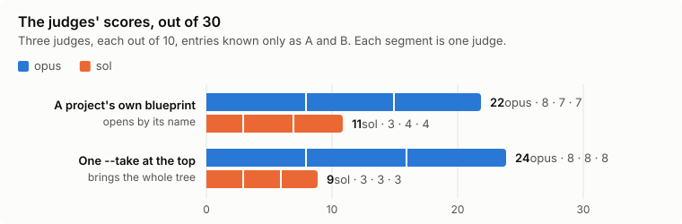
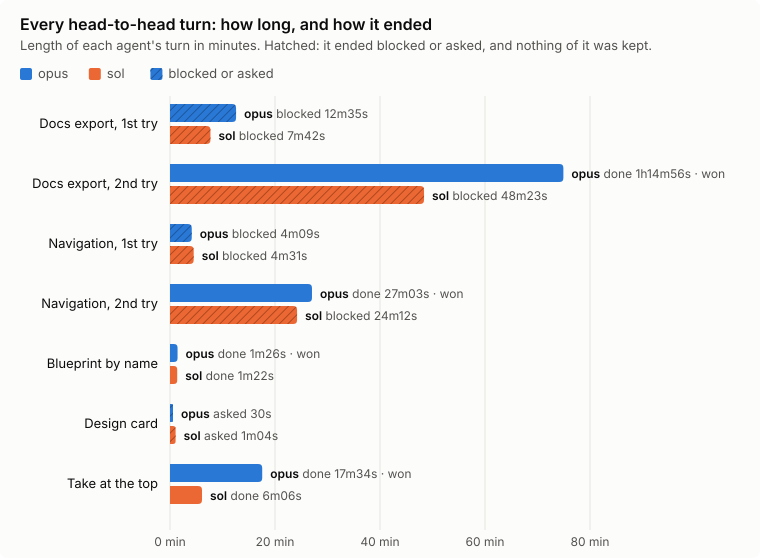

# A real A/B run: Claude Opus 5.5 against GPT-5.6 Sol

From 23 to 24 November 2026, the next five cards to reach `ready` on
Mythwright's own board were each worked twice, at the same time, by two
agents:

- **opus**: the `claude` package on the model `opus` (Claude Opus 5.5);
- **sol**: the `codex` package on the model `gpt-5.6-sol` (GPT-5.6 Sol).

Each worked in a worktree of its own. Neither could see the other's work.
Their entries were then judged blind, known only as A and B. This page is
what came of it.

It is a sample of the kind of report a factory gives you: every figure
below was read back from the factory that ran it, and the last section
says how to read the same figures from yours. It is five cards, so read it
as a worked example and a direction, not as a benchmark.

## At a glance

| | |
|---|---|
| Cards tested | 5 |
| Tests run (a card can be tested again) | 7 |
| Decided | 4 cards: **opus won all 4** |
| Not decided | 1 card: both stopped to ask the same three questions |
| Scored by judges | 2 cards, unanimous both times |
| Opus's dollars, its 7 turns | $69.88 |
| Sol's dollars, its 7 turns | not reported by its program |
| Everything the 5 cards cost (judges, reviews and other turns included) | $160.41, with Sol's 7 turns not priced |
| Winners that landed on `main` | 2 as they were after review; 2 finished in another session first |



## How it was set up

All of it is configuration: rows of the project's tables, `std/ab`
applied, and one blueprint of the project's own. Nothing in the program
was changed for it.

- **The contenders.** Two rows of the project's `agents` table, each with
  a role, a package and a model. They were told the same words, worked
  behind the same wall, had the same permission (`full`) and could read
  the same Rust toolchain.
- **Which cards.** A small blueprint of the project's own heard each card
  come to `ready`, held it until its test was laid, and stopped after the
  fifth. Nobody chose cards for the test; they were whatever came next.
- **The test.** The project's `contests` row for a card says what is
  done: both contenders work it, the losing branch is kept, and three
  judges score both entries out of ten (`std/judge-scores`). The higher
  total wins, and a tie goes to a person.
- **The judges.** Three agents with read-only permission, the `claude`
  package on `opus`, each scoring both entries known only by a letter.
- **After the test.** The winner's work became the card's and went to the
  fleet's reviewer as any card's would. The reviewer is a read-only agent
  that approves or sends back. Later rounds of the card went to the
  winner's agent.

## Card by card

| Card | Outcome | Opus | Sol | How it was decided |
|---|---|---|---|---|
| The program writes out its own docs (`mw docs export`, `mw help --json`, a new crate) | **opus** | done, 1h14m56s, $28.43, 94 files changed | blocked, 48m23s, 73 files | Only opus's work could be kept; a person took it |
| A library's page order and side navigation, written out and served | **opus** | done, 27m03s, $11.26, 14 files | blocked, 24m12s, 11 files | Only opus's work could be kept; a person took it |
| A project's own blueprint opens by its name | **opus** | done, 1m26s, $5.20, 3 files (+37 −2) | done, 1m22s, 3 files (+23 −5) | Judges: opus 8, 7, 7 (22); sol 3, 4, 4 (11) |
| Standard blueprints updated apart from the program (a design card) | none | asked, 30s, $3.30 | asked, 1m04s | Both stopped to ask, which kept nothing |
| One `--take` at the top brings a whole tree of blueprints along | **opus** | done, 17m34s, $3.10, 12 files (+281 −24) | done, 6m06s, 3 files (+101) | Judges: opus 8, 8, 8 (24); sol 3, 3, 3 (9) |



Times are the length of each agent's turn. Files are what its entry
changed.

The first two cards were each tested twice. The first time, **both**
contenders were blocked on both cards, for reasons that had nothing to do
with the models (see finding 5). Those first attempts cost opus $18.60
in 16m44s, and sol 12m13s.

### Every contender turn

| Card | Test | Agent | Ended | Took | Cost | Tokens sent | Tokens written |
|---|---|---|---|---|---|---|---|
| Docs export | 1st | opus | blocked | 12m35s | $13.15 | 39,421,333 | 77,978 |
| Docs export | 1st | sol | blocked | 7m42s | not reported | 4,498,159 | 19,683 |
| Docs export | 2nd | opus | done | 1h14m56s | $28.43 | 627,901 † | 78 † |
| Docs export | 2nd | sol | blocked | 48m23s | not reported | 72,556,457 | 65,250 |
| Navigation | 1st | sol | blocked | 4m31s | not reported | 1,461,646 | 11,003 |
| Navigation | 1st | opus | blocked | 4m09s | $5.45 | 9,688,256 | 25,685 |
| Navigation | 2nd | sol | blocked | 24m12s | not reported | 22,750,742 | 29,347 |
| Navigation | 2nd | opus | done | 27m03s | $11.26 | 1,877,349 † | 1,800 † |
| Blueprint by name | 1st | opus | done | 1m26s | $5.20 | 9,869,344 | 7,109 |
| Blueprint by name | 1st | sol | done | 1m22s | not reported | 861,521 | 2,937 |
| Design card | 1st | opus | asked | 30s | $3.30 | 1,539,841 | 2,403 |
| Design card | 1st | sol | asked | 1m04s | not reported | 743,764 | 2,632 |
| Take at the top | 1st | opus | done | 17m34s | $3.10 | 6,081,267 | 38,670 |
| Take at the top | 1st | sol | done | 6m06s | not reported | 2,175,371 | 7,802 |
| **All** | | **opus** | 4 done, 2 blocked, 1 asked | 2h18m13s | $69.88 | 69,105,291 | 153,723 |
| **All** | | **sol** | 2 done, 4 blocked, 1 asked | 1h33m21s | not reported | 105,047,660 | 138,654 |

† These two turns' token counts are far below what their cost and length
imply. They are shown as the program reported them, and nothing here
compares on them.

Each program counts its own tokens. "Sent" includes the context it sends
again at each step, so it runs far larger than anything typed, and one
program's count is not the same measure as the other's.

The judges cost $10.77 on the first scored card and $1.43 on the second.
The reviewer cost $45.01 over its five looks. Neither is in the totals
above.

## What it showed

**1. Opus won every card that came to a decision, four of four.** On the
two cards the judges scored, it was not close: 22 to 11 and 24 to 9.
Every judge put opus first both times.

**2. The judges gave the same reason: sol fixed the symptom, opus fixed
the cause.** On the blueprint card, sol's entry made the page stop
failing, but it showed a project's own blueprint as if it shipped with the
product: read-only, and labelled as shipped. On the take card, sol's
entry moved the pins of the parts below the top. All three judges found
that this left untouched the rule that made every changed part need
applying by hand, which was what the card was about. In both cases sol's
entry was smaller and its own tests passed. The tests just didn't reach
the case the card described.

**3. Sol was quicker and read less.** On the take card it finished in 6
minutes to opus's 17½, and it sent about a third of the tokens. On the
blueprint card the two took the same time, and sol sent less than a tenth.
When a card is small and well described, that difference is worth
measuring on more cards. Here, smaller was not enough to win.

**4. Two of the four results turned on how each agent reports a red gate
it did not cause.** On both large cards the project's full gate was red
because of a test that failed before either agent touched anything.
- **Sol** reported **blocked**, saying plainly that its own work's checks
  passed.
- **Opus** met the same failure on the navigation card, said so in the
  same terms, and reported **done**.

The fleet keeps no work an agent calls blocked, so sol's entries were
never judged at all. A person took the one entry left. The test measured
a rule of the fleet as much as it measured the models. The rule is a
setting, and a test that should judge blocked work is one row away from
it.

**5. The first attempts measured the setup, not the models.** On the
first try at each large card, both agents were blocked by their walls:
- opus's had `cargo` refused, waiting for an approval nobody was there to
  give;
- sol's had no Rust toolchain mounted.

That cost $18.60 of opus's turns and 29 minutes of both agents' time
before the setup was put right and the cards were tested again. Try a card through both setups before
you read anything into a result.

**6. Winning is not the same as shippable.** Each winner the reviewer
looked at was sent back once:
- **Docs export:** command forms that the program would refuse.
- **Navigation:** a browser check left unchanged, which would now fail.
- **Take at the top:** steps that could run twice, a `--back` that no
  longer undid it, and docs that were now false.

The reviewer reads only, and found all of this without running the test suites. A test chooses
between two entries. It doesn't make the chosen one right, so a review
after it is still needed.

**7. When both agents ask the same questions, the card is the problem.**
On the design card, both stopped within about a minute and asked the same
three things:
- whether the public release had happened;
- where a new version would come from;
- what a factory runs before anything is installed.

Neither guessed. That is a result too: a card two different models can't
start without the same answers is under-described.

**8. What this run cannot tell you.**
- **It is five cards.** The direction is clear, but it isn't a measure
  of how often.
- **The judges were opus too.** Entries were known only by letters, but
  judges of the same model as one contender may prefer its way of working.
  The next run should mix the judges, or have a person score a sample.
- **Sol's program reports no dollar cost.** So cost per accepted card,
  which a comparison is built to show, could only be read for one side.
- **What shipped is not what was judged for two cards.** The winning
  entries for the blueprint card and the take card were finished in
  another session, outside the factory, before they landed. The judging
  above is of the entries, not of what shipped.

**9. What the run found in the product.** Two things went wrong in the
factory itself during the run:
- **A plain "yes" was not taken as an answer.** A person asked "Take it
  (B)?" answered `yes`, and the test asked again for a letter.
- **A restart cancelled a test.** A daemon restarted during one test,
  which keeps nothing across a restart; it had to be applied again.

Both are the kind of thing a real run finds and a stand-in doesn't.

## Reading the same from your factory

Every figure above came from these, on the factory that ran it:

```sh
mw record list <project> contests          # each card's test: its contenders, judges, rule and winner
mw record list <project> entries           # each entry: its agent, branch, what it changed, its scores, kept or not
mw compare list                            # a comparison per test, named ab-<project>-contests-<n>
mw compare show ab-<project>-contests-<n>  # the two ways side by side: what came of each, what it spent, how long
mw board cost <card>                       # every round and turn of a card: who, what it chose, tokens, dollars, time
mw logs <run>                              # a test's run step by step, with each judge's scores as said
```

[A/B testing a card](ab-testing.md) says how to set a test up, and
[choosing a model or a prompt on your real work](example-choosing-models.md)
walks through one from the start.
